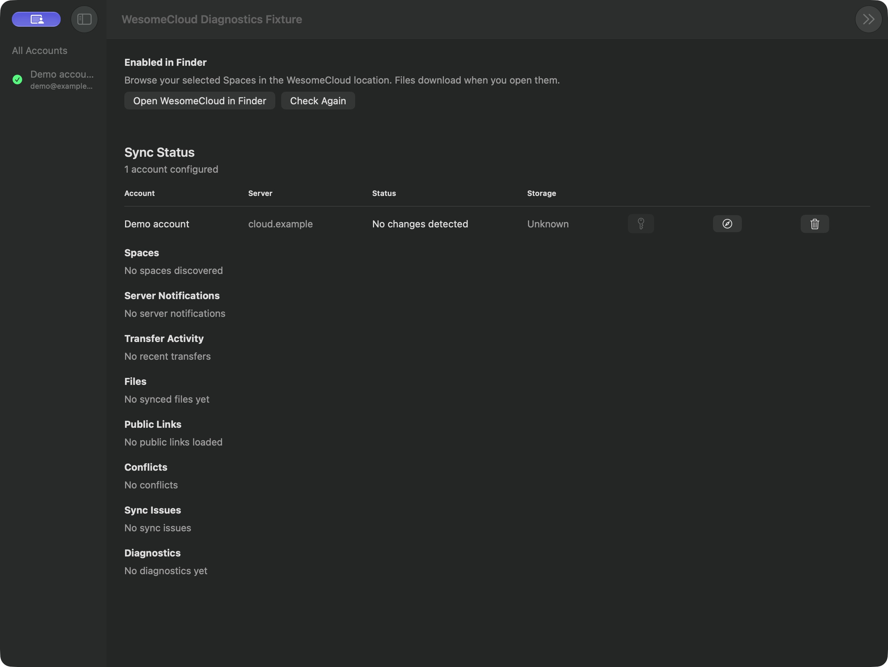
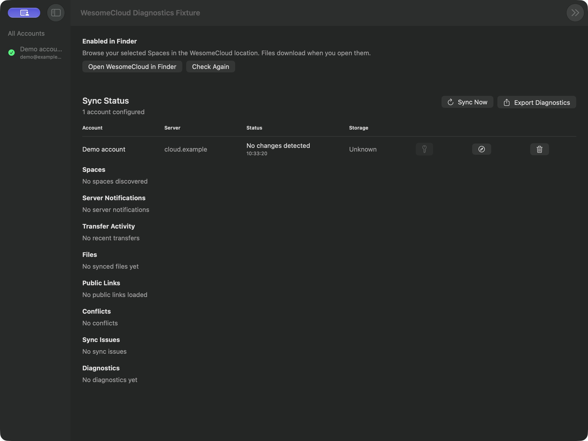

# Main-window diagnostics controls

Matched native screenshots at 1200 × 900 logical pixels, using the actual
`WesomeCloudRootView` before and after the change. Synthetic in-memory account
and Finder state keep real accounts and server data out of the evidence. These
images demonstrate button placement and the result timestamp; lifecycle and
export behavior are covered by the Swift tests.

Before:

After:

